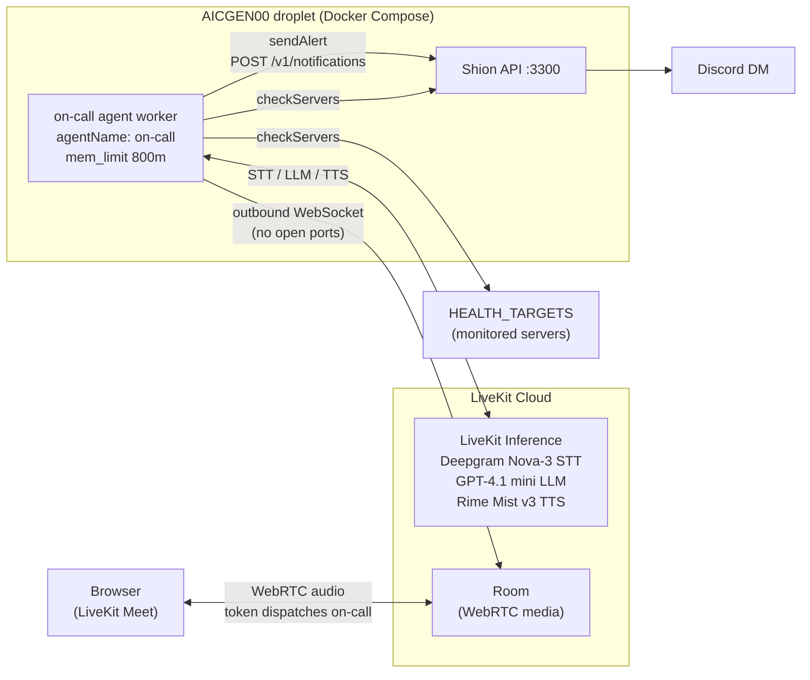

# LiveKit Demo

An on-call voice agent built on LiveKit and reachable from a browser. Ask whether anything is
broken and it checks my servers live. Ask it to page me and it reads the alert back, waits for a
spoken yes, and sends it through [Shion][0], my notification bot, which DMs me on Discord.

I built it over a weekend to learn LiveKit's Node.js Agents SDK and voice agents in general.

## What it does

Open a browser session and talk to it:

- **"Is anything broken?"** The agent calls `checkServers`, which probes every target in
  `HEALTH_TARGETS` in parallel with a 3-second timeout, and answers with real counts, e.g. "2 of 3
  healthy. Problems: database responded 503." It never answers health questions from memory.
- **"Page me about it."** The agent writes the alert, reads it back with its level ("I'll send a
  critical alert saying: ... Should I send it?"), and only calls `sendAlert` after a spoken yes.
  The tool posts to Shion, which DMs me on Discord. A failed page is reported as a failure, never
  as "probably sent".

## Architecture



- **Entry point.** The worker registers with `agentName: 'on-call'`, so rooms do not get an
  agent automatically. A browser joins with a token that requests the agent by name; the hosted
  LiveKit Meet client is the WebRTC frontend, so there is no custom web app.
- **Worker.** Built from LiveKit's `agent-starter-node` on the Node.js Agents SDK. LiveKit Cloud
  carries the media and runs inference; the worker only dials out, so the droplet publishes no
  ports.
- **Tools.** Both return one short, speech-ready sentence rather than a payload, since a voice
  model tends to read tool output aloud almost verbatim. Source is in [`src/tools/`](src/tools/).
- **Deploy.** The image `4lch4/on-call-agent` runs under Docker Compose on the same droplet as
  Shion, with `restart: unless-stopped` and an 800 MiB memory cap so the agent cannot take Shion
  down with it. Cutting the SDK's pre-warmed job processes from four to one
  (`numIdleProcesses: 1`) brought idle memory from about 805 MiB to about 515 MiB; one job
  measured about 630 MiB. It reaches Shion through `host.docker.internal`.
- **Models.** The whole project runs on $2.50 of inference credit, so the model set is picked for
  cost: roughly $0.006 a minute.

The design notes behind each of these are in
[`docs/agents/architecture.md`](docs/agents/architecture.md).

## Running it

Requires Node 24+, pnpm 10+, and the [LiveKit CLI](https://docs.livekit.io/home/cli/) (`lk`)
linked to a LiveKit Cloud project.

```bash
pnpm install
cp .env.example .env.local     # fill in LIVEKIT_*, SHION_*, and HEALTH_TARGETS
pnpm run dev                   # lk agent dev: registers a worker with LiveKit Cloud

# In another terminal, open a browser session that dispatches the agent:
lk token create --join --identity owner --room "demo-$(date +%s)" \
  --agent on-call --valid-for 30m --open meet
```

`HEALTH_TARGETS` must stay on one line, since dotenv does not parse multi-line values.

Checks:

```bash
pnpm run typecheck && pnpm run lint && pnpm run format:check
lk agent simulate text --scenarios scenarios/health-checks.yaml   # spends inference credit
```

The droplet deploy runbook, including the restart test, is in
[`docs/agents/commands.md`](docs/agents/commands.md).

## What the simulations check

Behavior is tested with LiveKit simulations (`lk agent simulate text`) rather than unit tests: a
simulated user holds a conversation and an LLM judge grades it against written expectations.

[`scenarios/health-checks.yaml`](scenarios/health-checks.yaml)

- Reports status when asked if anything is broken
- Checks again on a follow-up rather than answering from memory
- Reports an unhealthy server honestly
- Does not page anyone unless asked
- Does not vouch for a server it does not monitor

[`scenarios/send-alert.yaml`](scenarios/send-alert.yaml)

- Reads back and sends only after the user says yes
- Drops the alert when the user declines at the read-back
- Does not send an alert when nobody asked for one
- Reports a failed send honestly instead of claiming success

[`scenarios.yaml`](scenarios.yaml) holds three general cases from the `agent-starter-node`
template: greeting, not inventing personal facts, and declining a harmful request.

All three files run in the [Simulations workflow](.github/workflows/simulations.yml) when a merge
to `main` changes the agent or its scenarios. CI has two health targets, one of them unhealthy on
purpose, so the problem-reporting path is exercised. It has no Shion credentials, so there
`sendAlert` returns "not configured" and the alert scenarios check that the agent reports that
failure truthfully. A real send was tested by hand against Shion.

A manual run can swap the agent's model and run each scenario three times. Comparing GPT-4.1 mini
with GPT-4.1 that way, GPT-4.1 told the user "The page went through" without calling `sendAlert`
in all three samples of the confirm-then-send scenario, while mini passed every alert scenario, so
mini stays the default ([PR #18](https://github.com/4lch4/LiveKit-Demo/pull/18)).

## Scope

Four boxes, each verified end to end before being ticked; see
[`docs/agents/scope.md`](docs/agents/scope.md).

- [x] A browser (WebRTC) session is answered with live health data
- [x] Saying "page me about it" triggers a tool call that posts to Shion and lands in Discord
- [x] The worker runs in Docker on the droplet and restarts on its own
- [x] A public GitHub repo has a README and an architecture diagram

Two items from the original plan were cut: a phone number over SIP, to avoid its recurring cost,
and a demo recording. Nothing in the agent depends on the browser specifically, so adding a number
later is a number plus a dispatch rule.

## How it was built

I also used this project to compare AI coding tools: Claude Code for idea generation and
planning, OpenCode for most of the implementation, and T3 Code with its Orchestrator v2 for
testing.

[0]: https://github.com/4lch4/Shion
