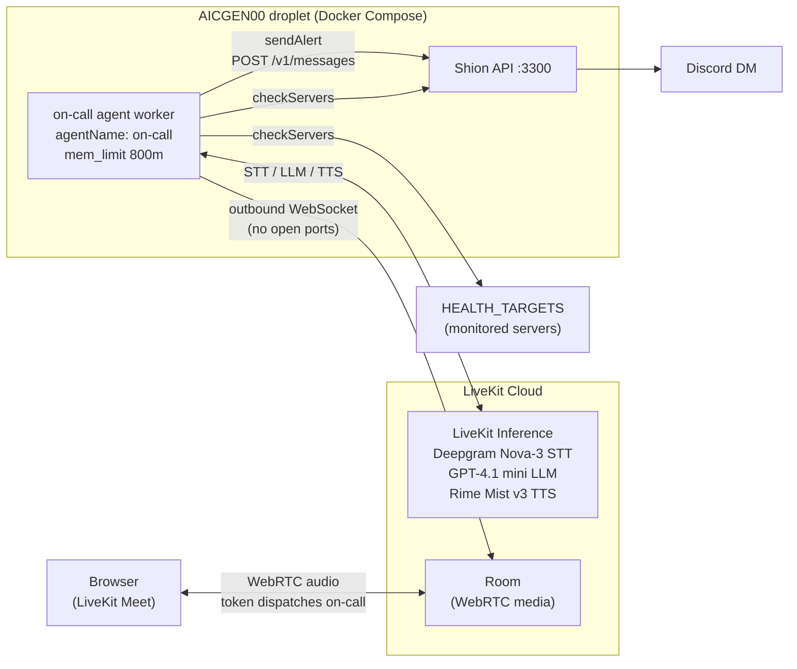

# LiveKit Demo

This repository is home to my demo deployment of an agent using LiveKit. It's a weekend project to familiarize myself with LiveKit's capabilities, particularly in the context of voice agents. The goal is to create a functional on-call voice agent that can be reached via a browser, capable of handling inquiries and paging the owner through [Shion][0] (my personal notification bot) when necessary.

I'm creating it with the intention of learning and experimenting with Claude Code, OpenCode, and T3 Code. I'm using Claude for the idea generation and planning, OpenCode for the coding and implementation, and T3 Code for testing with the new Orchestrator v2. The project is structured to be modular, allowing for easy updates and improvements as I learn more about LiveKit and voice agent development.

## What it does

Open a browser session and talk to it:

- **"Is anything broken?"** The agent calls `checkServers`, which probes every target in
  `HEALTH_TARGETS` in parallel with a 3-second timeout, and answers with real counts, e.g. "2 of 3
  healthy. Problems: database responded 503." It never answers health questions from memory.
- **"Page me about it."** The agent writes the alert, reads it back with its level ("I'll send a
  critical alert saying: ... Should I send it?"), and only calls `sendAlert` after a spoken yes.
  The tool posts to Shion, which DMs me on Discord. A failed page is reported as a failure, never
  as "probably sent".

## Architecture



- **Entry point.** The worker registers with `agentName: 'on-call'`, so rooms do not get an
  agent automatically. A browser joins with a token that requests the agent by name; the hosted
  LiveKit Meet client is the WebRTC frontend, so there is no custom web app.
- **Worker.** Built from LiveKit's `agent-starter-node` on the Node.js Agents SDK. LiveKit Cloud
  carries the media and runs inference; the worker only dials out, so the droplet publishes no
  ports.
- **Tools.** Both return one short, speech-ready sentence rather than a payload, since a voice
  model tends to read tool output aloud almost verbatim. Source is in [`src/tools/`](src/tools/).
- **Deploy.** The image `4lch4/on-call-agent` runs under Docker Compose on the same droplet as
  Shion, with `restart: unless-stopped` and a memory cap so the agent cannot take Shion down with
  it. It reaches Shion through `host.docker.internal`.
- **Models.** The whole project runs on $2.50 of inference credit, so the model set is picked for
  cost: roughly $0.006 a minute.

The design notes behind each of these are in
[`docs/agents/architecture.md`](docs/agents/architecture.md).

## Running it

Requires Node 24+, pnpm 10+, and the [LiveKit CLI](https://docs.livekit.io/home/cli/) (`lk`)
linked to a LiveKit Cloud project.

```bash
pnpm install
cp .env.example .env.local     # fill in LIVEKIT_*, SHION_*, and HEALTH_TARGETS
pnpm run dev                   # lk agent dev: registers a worker with LiveKit Cloud

# In another terminal, open a browser session that dispatches the agent:
lk token create --join --identity owner --room "demo-$(date +%s)" \
  --agent on-call --valid-for 30m --open meet
```

`HEALTH_TARGETS` must stay on one line, since dotenv does not parse multi-line values.

Checks:

```bash
pnpm run typecheck && pnpm run lint && pnpm run format:check
lk agent simulate text --scenarios scenarios.yaml   # judged conversations; spends inference credit
```

Behavior is covered by the simulation scenarios in [`scenarios.yaml`](scenarios.yaml) and
[`scenarios/`](scenarios/) rather than unit tests. The droplet deploy runbook, including the
restart test, is in [`docs/agents/commands.md`](docs/agents/commands.md).

## Scope

Four boxes, each verified end to end before being ticked; see
[`docs/agents/scope.md`](docs/agents/scope.md).

- [x] A browser (WebRTC) session is answered with live health data
- [x] Saying "page me about it" triggers a tool call that posts to Shion and lands in Discord
- [x] The worker runs in Docker on the droplet and restarts on its own
- [x] A public GitHub repo has a README and an architecture diagram

Two items from the original plan were cut: a phone number over SIP, to avoid its recurring cost,
and a demo recording. Nothing in the agent depends on the browser specifically, so adding a number
later is a number plus a dispatch rule.

[0]: https://github.com/4lch4/Shion
